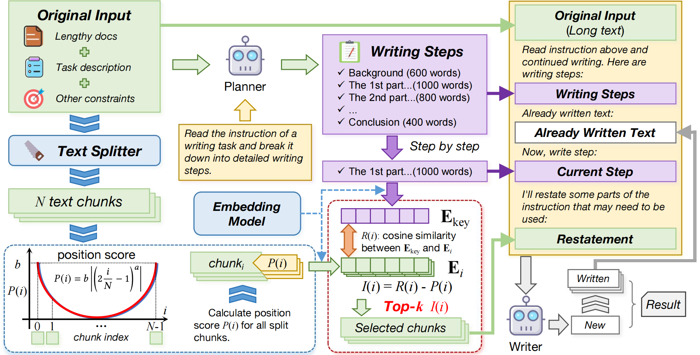

# RAL-Writer LLM Agent & LongInOutBench

## 📖 Introduction

This repository contains the code and data for the paper **"Lost-in-the-Middle in Long-Text Generation: Synthetic Dataset, Evaluation Framework, and Mitigation"**.

**RAL-Writer** is a specialized LLM agent designed to produce **high-quality, logically structured long-form articles (10k+ tokens)** while effectively processing and referencing multiple source documents. Unlike standard text generators, RAL-Writer demonstrates exceptional capability in:
- Analyzing and synthesizing information from **large reference collections**
- Maintaining coherent narrative flow in extended outputs
- Adapting writing style to match user specifications



`dataset` is our newly proposed benchmark for evaluating LLM performance on **long input-long output tasks**, using the challenging "multi-document summarization" task as its core evaluation paradigm.

## ✨ Key Features

### RAL-Writer Agent
- **Reference Integration**: Seamlessly processes 50k+ words documents
- **Contextual Understanding**: Identifies key concepts and connections across sources
- **Adaptive Generation**: Maintains coherence in 10k+ token outputs
- **Style Control**: Supports various writing tones and formats

### Dataset
- Standardized evaluation for long-context LLMs
- Quantitative metrics for:
  - Reference utilization accuracy
  - Quality of generated summaries
  - Length scalability
- Pre-processed datasets with 100 test cases

## 🚀 Quick Start

### Installation

```shell
pip install -r requirements.txt
```

### Basic Usage

Provide a `.env` file with your OpenAI API key:

```dotenv
OPENAI_BASE_URL=deployed_llm_base_url
OPENAI_API_KEY=sk-xxxx
```

Copy `src/*` to your project directory and import the `RestateAgent` class:

```python
import dotenv

dotenv.load_dotenv()

from agent.restate import RestateAgent

agent = RestateAgent(chunk_size=1024, overlap=256, a=60, b=0.3, top_k=8, tqdm=False)

output = agent.write(instruction="""
Write a 10k-word article on the topic of 'Artificial Intelligence'.

Reference the following documents:
...(You can provide 50k+ words of reference material here)
""", model="qwen2.5-14b-instruct")

print(output.choices[0].message.content)
```

### Experiment

Evaluation Pipeline Steps:

1. Summary Generation from Provided Papers:

```shell
python experiments/pred.py
```

> In compress agent, an llmlingua server is required to run the experiment. Please refer to the [LLMLingua](https://github.com/microsoft/LLMLingua) repository for more information.

2. Consistency Score Evaluation:

```shell
python experiments/consistency_score.py
```

3. Quality Score Evaluation:

```shell
python experiments/quality_score.py
```

4. Length Score Evaluation:

```shell
python experiments/length_score.py
```